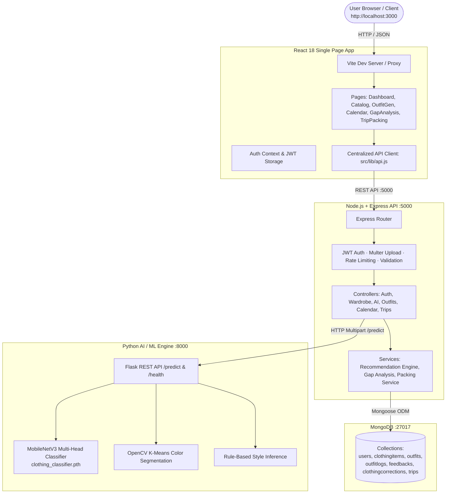

# 🧥 Alcove — Smart Wardrobe & AI Outfit Planner

<div align="center">


### *Intelligent, Privacy-First, 100% On-Device Wardrobe Management & Outfit Recommendation Engine*

[](https://react.dev/)
[](https://nodejs.org/)
[](https://www.mongodb.com/)
[](https://www.python.org/)
[](https://pytorch.org/)
[](https://opencv.org/)
[](#privacy-first-offline-architecture)

[Demo Video](#-product-demo-video) • [Features](#-key-features) • [Screenshots](#-visual-showcase) • [Architecture](#-system-architecture) • [Tech Stack](#-technology-stack) • [Quick Start](#-quick-start-installation) • [AI / ML Pipeline](#-ai--computer-vision-engine) • [API Reference](#-api-endpoints) • [Project Structure](#-project-structure)

</div>

---

## 🎥 Product Demo Video

<div align="center">

<!-- 
  =============================================================================
  HOW TO ADD YOUR VIDEO ON GITHUB:
  Option 1 (Recommended - GitHub hosted):
    1. Open your repository on GitHub in your browser.
    2. Click the pencil icon to edit README.md (or drag into any Issue/PR comment box).
    3. Drag & drop your video file (.mp4, .mov, or .webm) directly into the box.
    4. GitHub will upload it and generate a URL like:
       https://github.com/user-attachments/assets/xxxxxxxx-xxxx-xxxx-xxxx-xxxxxxxxxxxx
    5. Replace "YOUR_VIDEO_URL_HERE" below with that link!

  Option 2 (Local file in repo):
    Commit a video (e.g., demo.mp4) into this repo and change src="demo.mp4".
  =============================================================================
-->

<video src="YOUR_VIDEO_URL_HERE" controls="controls" muted="muted" width="100%" poster="WEBIMAGES/Screenshot%202026-07-22%20214931.png" style="max-width: 100%; border-radius: 12px; box-shadow: 0 10px 30px rgba(0,0,0,0.4);">
  <p>Your browser does not support HTML5 video. <a href="YOUR_VIDEO_URL_HERE">Click here to watch the demo video</a>.</p>
</video>

<p><em>✨ Watch Alcove in action — AI auto-tagging, outfit recommendations, and wardrobe analytics</em></p>

</div>

---

## 📖 Overview

**Alcove** is a modern, full-stack, on-device smart wardrobe platform that bridges fashion styling and computer vision. Most existing wardrobe applications upload personal photos to third-party cloud vision APIs (such as Google Cloud Vision or OpenAI GPT-4 Vision), which incurs recurring API costs and compromises personal privacy. 

Alcove changes that by running **100% locally on your machine**:
- **Zero Cloud API Fees**: High-accuracy deep learning inference runs entirely on your local hardware using PyTorch and OpenCV.
- **Complete Privacy**: Personal clothing photos, styling history, and calendar records never leave your local environment.
- **Multi-Factor Recommendation**: Outfits are evaluated against a **100-point scoring algorithm** combining weather, occasion, color harmony, style coherence, and seasonal fit.
- **Glassmorphic UI**: Built with a sleek, ultra-responsive dark glassmorphic design system using React 18 and Tailwind CSS.

---

## ✨ Key Features

### 1. 👚 Digital Wardrobe Cataloging & Smart Tagging
- **Drag-and-Drop Ingestion**: Instant image upload with automatic client-side compression and validation.
- **Multi-Attribute Tracking**: Tracks Category, Sub-type, Colors (Primary & Accent), Pattern, Style, Season, Formality, Brand, Material, and Wardrobe Location.
- **Garment Lifecycle**: Dynamic status tags (`available`, `laundry`, `packed`, `donated`).
- **Interactive Filtering**: Filter by category, occasion, color palette, or status with instant search.

### 2. 🧠 On-Device Deep Learning & Computer Vision
- **MobileNetV3-Large Classifier**: Multi-head convolutional neural network that detects category, pattern, season, and formality in real-time.
- **K-Means Color Extraction & Segmentation**: Foreground segmentation using OpenCV and K-Means clustering in Lab color space to identify dominant colors.
- **Human-in-the-Loop Review**: Automatically flags predictions with confidence below 60% for user confirmation.
- **Continuous Learning Loop**: Logs user corrections (`ClothingCorrection`) to curate refined training datasets.

### 3. 🎯 100-Point Outfit Recommendation Engine
- Synthesizes balanced outfits (Tops + Bottoms + Shoes + Outerwear + Accessories or One-Piece Dresses).
- **Explainable Multi-Factor Scoring**:
  - 🌦️ **Weather Suitability (30 pts)**: Matches temperature and forecast conditions.
  - 👔 **Occasion Appropriateness (25 pts)**: Tailored for Casual, Work, Formal, Sport, or Party.
  - 🎨 **Color Harmony Matrix (20 pts)**: Evaluates complementary, analogous, and neutral color pairings.
  - 🕶️ **Style Consistency (15 pts)**: Ensures aesthetic cohesion (Minimalist, Streetwear, Business, etc.).
  - 🍂 **Seasonal Relevance (10 pts)**: Prioritizes climate-appropriate fabric weights.
- **Explainable AI Notes**: Each recommendation includes clear natural-language reasons for its selection.

### 4. 📊 Wardrobe Analytics & Gap Analysis
- Visual category coverage bars comparing closet composition against curated wardrobe targets.
- Missing category alerts and closet deficiency warnings.
- Occasion readiness gauges (e.g., Casual: 100%, Formal: 40%).
- Actionable, personalized shopping advice to fill genuine wardrobe voids.

### 5. 📅 Wear History Calendar & Item Utilization
- Interactive monthly calendar tracking outfits worn each day.
- Logs daily wear counts to eliminate closet stagnation and address the "wear 20% of clothes 80% of the time" paradox.
- Displays wear freshness tags (`Worn 2 days ago`, `Unworn this season`).

### 6. 🧳 Smart Trip Capsule Packing Planner
- Algorithmic packing formula based on destination, travel duration, and expected occasions.
- Selects versatile, mix-and-match garments with preference for least-worn items.
- Provides an interactive checklist with packed/unpacked state toggles.

### 7. 🔗 Lookbook & Public Outfit Sharing
- Save custom combinations into personalized Lookbooks.
- Generate shareable guest URLs (`/share/:id`) that don't require an account to view.
- Collect peer feedback and stylist ratings (upvotes, downvotes, styling notes).

---

## 📸 Visual Showcase

<div align="center">

### Main Dashboard Overview
*Real-time wardrobe analytics, quick actions, weather widgets, and recent recommendations*


---

### Digital Wardrobe Catalog
*Browse, search, and filter garments with AI badges and status indicators*


---

### AI Outfit Generator
*Live weather integration, occasion toggles, and multi-factor 100-point compatibility scoring*


---

### Wardrobe Gap Analysis & Shopping Advice
*Closet distribution analysis, deficiency warnings, and curated recommendations*


---

### Wear History Calendar
*Monthly outfit logs, wear frequency counts, and outfit history*


---

### Smart Trip Packing Planner
*Capsule wardrobe generator tailored to destination length and occasion mix*


---

### Public Outfit Sharing & Feedback
*Shareable outfit links with friend/stylist voting and comments*


---

### Authentication Portal
*Secure glassmorphic login & registration with JWT session handling*


</div>

---

## 🏗️ System Architecture

Alcove is architected as a clean, decoupled 3-tier microservice system:



---

## 💻 Technology Stack

| Layer | Technologies | Details |
|---|---|---|
| **Frontend** | React 18, Vite 5, Tailwind CSS 3, Lucide React, React Router v6 | Glassmorphic design, SPA routing, responsive desktop/mobile UI |
| **Backend API** | Node.js 18+, Express 4, Mongoose 8, Multer, Sharp, JWT, bcryptjs | RESTful API, authentication middleware, file processing, recommendation algorithms |
| **Database** | MongoDB 6.0+ | Document store for users, clothing items, outfits, calendar wear history, and trips |
| **AI / ML Engine** | Python 3.10+, PyTorch 2.2, Torchvision, OpenCV, Scikit-learn, Flask | MobileNetV3-Large multi-head transfer learning, GrabCut foreground segmentation, K-Means Lab color clustering |
| **Tooling & Env** | Nodemon, PostCSS, Autoprefixer, Git | Local dev servers, hot-reloading, environment isolation |

---

## 🚀 Quick Start Installation

### Prerequisites
Make sure you have the following installed on your machine:
- [Node.js](https://nodejs.org/) (v18.x or v20.x recommended)
- [Python](https://www.python.org/) (v3.10 or higher)
- [MongoDB Community Server](https://www.mongodb.com/try/download/community) (running locally on port 27017 or MongoDB Atlas connection string)
- [Git](https://git-scm.com/)

---

### Step 1: Clone Repository

```bash
git clone https://github.com/<your-username>/<your-repo-name>.git
cd "Smart Waredrob"
```

---

### Step 2: Configure Environment Variables

1. **Backend Environment**:
   ```bash
   cd backend
   cp .env.example .env
   ```
   *(On Windows Command Prompt / PowerShell, use `copy .env.example .env`)*

2. **Frontend Environment** *(optional, default is `http://localhost:5000`)*:
   ```bash
   cd ..
   cp .env.example .env.local
   ```

---

### Step 3: Start MongoDB

- **Local MongoDB**:
  ```bash
  mongod
  ```
  *(Default connection: `mongodb://localhost:27017/alcove`)*

- **MongoDB Atlas**:
  Update `MONGODB_URI` in `backend/.env` with your connection string.

---

### Step 4: Run the Application (3 Terminals)

Open **three separate terminal windows** for the three services:

#### 🟢 Terminal 1: Backend API (Port 5000)
```bash
cd backend
npm install
npm run dev
```
*Backend runs at:* `http://localhost:5000`

#### 🟣 Terminal 2: AI Engine (Port 8000)
```bash
cd ai-engine
# Create virtual environment
python -m venv venv

# Activate virtual environment
# Windows:
venv\Scripts\activate
# macOS / Linux:
source venv/bin/activate

# Install AI dependencies
pip install -r requirements.txt

# Start the Flask AI server
python server.py
```
*AI Engine runs at:* `http://localhost:8000`  
*(Note: A pre-trained model `clothing_classifier.pth` is included in `ai-engine/models/` for immediate use!)*

#### 🔵 Terminal 3: Frontend Web App (Port 3000 / 5173)
```bash
# In the root directory
npm install
npm run dev
```
*Frontend runs at:* `http://localhost:3000` (or `http://localhost:5173`)

Open `http://localhost:3000` in your browser, register an account, and start organizing your wardrobe!

---

## 🤖 AI / Computer Vision Engine

### Architecture of the Vision Model
1. **Backbone**: MobileNetV3-Large pre-trained on ImageNet for high-accuracy feature extraction with minimal CPU/GPU latency.
2. **Multi-Head Classification**: Simultaneously classifies:
   - Primary category (Tops, Bottoms, Outerwear, Dresses, Shoes, Accessories)
   - Pattern (Solid, Striped, Floral, Plaid, Printed, Graphic)
   - Season (Spring, Summer, Fall, Winter, All-Season)
   - Formality level (Casual, Smart Casual, Business Formal, Evening)
3. **Color Extraction**:
   - Uses OpenCV for foreground masking to ignore background clutter.
   - Applies K-Means clustering in CIELAB color space to identify dominant and secondary colors.
   - Maps Lab centroids to standard fashion color names (Navy, Olive, Burgundy, Beige, etc.).

### Training Your Own Custom Model (Optional)
If you wish to train or fine-tune the model with custom Kaggle datasets:

1. **Recommended Datasets**:
   - [Fashion Product Images (Small)](https://www.kaggle.com/datasets/paramaggarwal/fashion-product-images-small)
   - [Clothing Dataset Full](https://www.kaggle.com/datasets/agrigorev/clothing-dataset-full)

2. **Dataset Placement**:
   Place your raw images organized in category folders in `ai-engine/datasets/raw/`.

3. **Run Preprocessing & Training**:
   ```bash
   cd ai-engine
   # 1. Inspect and validate image dimensions & labels
   python preprocessing/dataset_inspector.py --dataset_dir datasets/raw

   # 2. Build train/val/test splits
   python preprocessing/dataset_builder.py --dataset_dir datasets/raw

   # 3. Train MobileNetV3
   python training/train.py --epochs 20 --batch_size 32

   # 4. Evaluate precision/recall/F1 metrics
   python training/evaluate.py
   ```

---

## 📡 API Endpoints

| Method | Endpoint | Description | Auth Required |
|---|---|---|---|
| `POST` | `/api/auth/register` | Register new user account | No |
| `POST` | `/api/auth/login` | Login and obtain JWT token | No |
| `GET` | `/api/auth/me` | Fetch authenticated user profile & spaces | Yes |
| `GET` | `/api/wardrobe` | List user clothing items (with filtering & search) | Yes |
| `POST` | `/api/wardrobe` | Add new clothing item with photo upload | Yes |
| `PUT` | `/api/wardrobe/:id` | Update clothing item metadata/status | Yes |
| `DELETE` | `/api/wardrobe/:id` | Remove clothing item | Yes |
| `POST` | `/api/ai/analyze` | Send image to local AI engine for auto-tagging | Yes |
| `POST` | `/api/ai/correct` | Submit human correction for continuous learning | Yes |
| `POST` | `/api/outfits/generate` | Generate 100-pt scored outfit recommendations | Yes |
| `POST` | `/api/outfits/save` | Save outfit to personal lookbook | Yes |
| `POST` | `/api/outfits/wear` | Log outfit worn today and record to calendar | Yes |
| `GET` | `/api/outfits/share/:id` | View public shared outfit details | No |
| `POST` | `/api/outfits/share/:id/feedback`| Submit guest feedback on shared outfit | No |
| `GET` | `/api/calendar` | Retrieve monthly wear history and logs | Yes |
| `POST` | `/api/trips/pack` | Generate smart capsule packing list | Yes |
| `GET` | `/api/wardrobe/gap-analysis` | Compute wardrobe coverage and deficiencies | Yes |

*See [`API_DOCUMENTATION.md`](API_DOCUMENTATION.md) for full request/response schemas and examples.*

---

## ⚙️ Environment Variables

### Backend Configuration (`backend/.env`)

```ini
PORT=5000                                           # Express server port
NODE_ENV=development                                # Environment mode
MONGODB_URI=mongodb://localhost:27017/alcove        # MongoDB URI
JWT_SECRET=your_jwt_secret_key_change_in_production # Secret for JWT signing
JWT_EXPIRES_IN=7d                                   # Token expiration
AI_ENGINE_URL=http://localhost:8000                 # Python AI engine URL
UPLOAD_DIR=uploads                                  # Upload directory
MAX_FILE_SIZE_MB=10                                 # File upload limit
CORS_ORIGIN=http://localhost:3000,http://localhost:5173 # Allowed origins
```

### Frontend Configuration (`.env.local`)

```ini
# Backend API URL
VITE_API_URL=http://localhost:5000
```

---

## 📂 Project Structure

```
Smart Waredrob/
├── WEBIMAGES/                    # High-resolution application screenshots
├── src/                          # React 18 Frontend
│   ├── pages/                    # Core application views
│   │   ├── Login.jsx             # Authentication portal
│   │   ├── Dashboard.jsx         # Main wardrobe dashboard & statistics
│   │   ├── AddItem.jsx           # Photo upload & vision AI auto-tagging
│   │   ├── OutfitGenerator.jsx   # Weather-aware outfit recommendations
│   │   ├── GapAnalysis.jsx       # Closet analytics & shopping advice
│   │   ├── CalendarPage.jsx      # Wear history calendar
│   │   ├── TripPacking.jsx       # Capsule trip packing assistant
│   │   ├── SharedOutfit.jsx      # Public guest outfit sharing view
│   │   └── Profile.jsx           # User settings & wardrobe spaces
│   ├── components/               # Glassmorphic UI component library
│   ├── context/                  # AuthContext (JWT session state)
│   └── lib/                      # Centralized API client (api.js)
│
├── backend/                      # Node.js + Express REST API
│   ├── src/
│   │   ├── controllers/          # Request handlers for auth, wardrobe, AI, outfits, trips
│   │   ├── models/               # Mongoose schemas (User, ClothingItem, Outfit, Trip, etc.)
│   │   ├── middleware/           # JWT authentication, Multer uploads, validation
│   │   ├── routes/               # Express routing tables
│   │   ├── services/             # Recommendation scoring, gap analysis, packing math
│   │   └── app.js                # Express entrypoint
│   ├── uploads/                  # User image storage (.gitkeep preserved)
│   └── package.json
│
├── ai-engine/                    # Python AI / Computer Vision Engine
│   ├── inference/
│   │   ├── predictor.py          # PyTorch inference with MobileNetV3
│   │   ├── color_detector.py     # OpenCV Lab K-Means color clustering
│   │   └── style_engine.py       # Style rule inference engine
│   ├── preprocessing/            # Image processing and dataset builders
│   ├── training/                 # Model training and evaluation scripts
│   ├── models/                   # Pre-trained checkpoint (clothing_classifier.pth)
│   ├── datasets/                 # Dataset reports and raw data folder
│   ├── server.py                 # Flask REST server (:8000)
│   └── requirements.txt          # Python dependencies
│
├── Document/                     # Project reports, diagrams, and research papers
├── .env.example                  # Frontend environment template
├── .gitignore                    # Production git ignore configuration
├── ARCHITECTURE.md               # Detailed technical architecture design
├── API_DOCUMENTATION.md          # REST API specifications and contracts
├── PROJECT_EXPLANATION.md        # Comprehensive technical documentation
├── OFFLINE_SETUP.md              # Offline installation guide
├── AI_BEGINNER_GUIDE.md          # Guide to the machine learning pipeline
├── HOW_TO_RUN.txt                # Quick command cheat sheet
└── README.md                     # Project repository README
```

---

## 📚 Deep Dive Documentation

For in-depth guides and technical details, consult:
- 🏛️ [**System Architecture (`ARCHITECTURE.md`)**](ARCHITECTURE.md) — Architectural diagrams and data flow.
- 📡 [**API Documentation (`API_DOCUMENTATION.md`)**](API_DOCUMENTATION.md) — Endpoint specifications, payloads, and responses.
- 📝 [**Comprehensive Project Report (`PROJECT_EXPLANATION.md`)**](PROJECT_EXPLANATION.md) — Complete 300+ line technical breakdown.
- 🔌 [**Offline Setup Guide (`OFFLINE_SETUP.md`)**](OFFLINE_SETUP.md) — Running fully disconnected from the internet.
- 🎓 [**AI Beginner Guide (`AI_BEGINNER_GUIDE.md`)**](AI_BEGINNER_GUIDE.md) — Understanding the ML training and inference pipelines.

---

## 🔒 Privacy & Security

- **Zero Cloud Leakage**: All garment photos are processed by the Python AI server running on `localhost:8000`.
- **Encrypted Authentication**: Passwords hashed with `bcryptjs` (salt rounds: 12).
- **JWT Protection**: Secure HTTP authorization tokens with configurable expiration.
- **Strict CORS & Input Validation**: Rate limiting, sanitize middleware, and parameterized database queries prevent injection attacks.

---

## 🤝 Contributing

Contributions, issues, and feature requests are welcome!

1. Fork the Project
2. Create your Feature Branch (`git checkout -b feature/AmazingFeature`)
3. Commit your Changes (`git commit -m "feat: add AmazingFeature"`)
4. Push to the Branch (`git push origin feature/AmazingFeature`)
5. Open a Pull Request

---

## 📄 License

This project is open-source and available under the [MIT License](LICENSE).

---

<div align="center">
Made with ❤️ for smart, sustainable, and privacy-first fashion.
</div>
